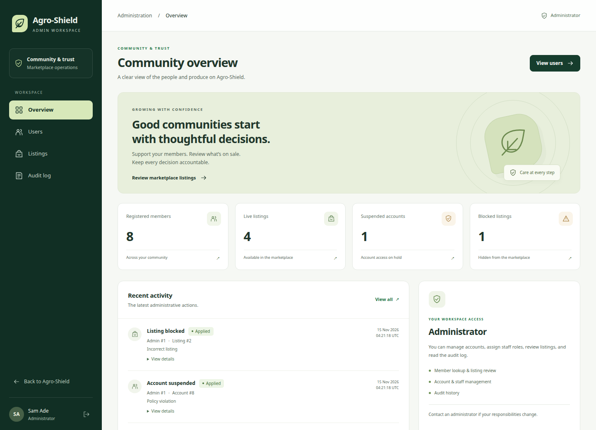
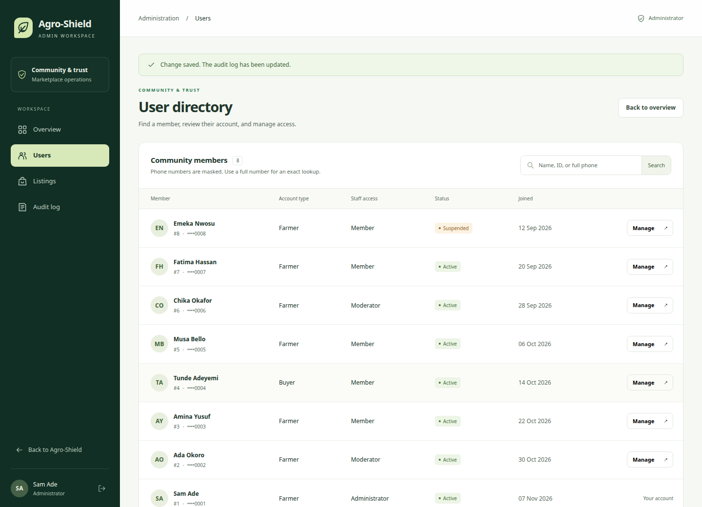
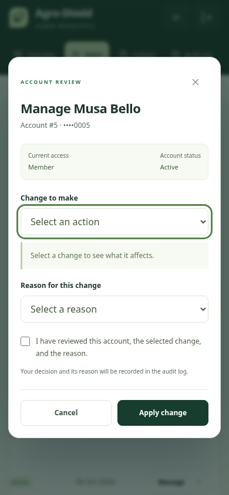
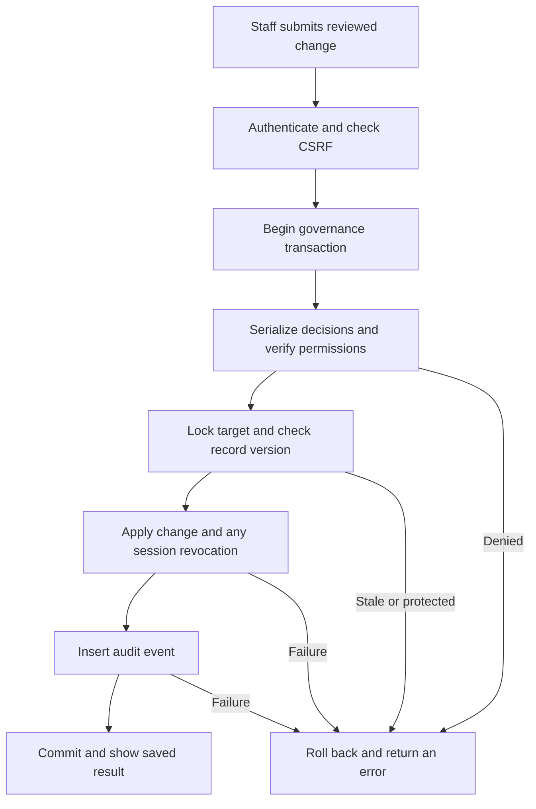

# Agro-Shield Role 6: Implementation Record and Admin User Guide

**Workstream:** Administration and accountability — Role 6 only  
**Issues:** AGRO-008, persistent administrative audit; AGRO-019, user management and listing moderation  
**Documented on:** November 15, 2026; updated November 16, 2026  
**Implementation branch:** `feat/admin-governance`  
**Implementation commit:** `1aba44c` — `feat(admin): implement governance and persistent audit`  
**Baseline commit:** `8bc0a90`  
**Delivery status:** Role 6 implementation completed and locally verified. Core implementation committed locally; the final listing-review fix, explicit legacy import, connection correction, canonical phone handling, confirmed test-duplicate cleanup, and expanded guide are working-tree changes. Hosted CI, independent review, and merge remain outstanding.

This document records what was delivered, why the implementation was designed this way, how every admin screen works, and how the work was verified. It describes the core implementation at the commit above and the subsequent listing-review fix and explicitly requested legacy-data migration. The screenshots contain synthetic demonstration accounts and figures.

## Contents

- [Scope and delivery record](#scope-and-delivery-record)
- [Getting into the admin console](#getting-into-the-admin-console)
- [Roles and permissions](#roles-and-permissions)
- [Navigation and shared layout](#navigation-and-shared-layout)
- [Overview page](#overview-page)
- [Users page](#users-page)
- [Listing moderation page](#listing-moderation-page)
- [Audit log page](#audit-log-page)
- [Wallet approvals integration](#wallet-approvals-integration)
- [Confirmation and error states](#confirmation-and-error-states)
- [Implementation decisions and reasons](#implementation-decisions-and-reasons)
- [File-by-file change record](#file-by-file-change-record)
- [Verification record](#verification-record)
- [Deployment and handoff](#deployment-and-handoff)
- [Quick walkthrough](#quick-walkthrough)

## Scope and delivery record

The work follows Role 6 in the [eight-member remediation plan](AGRO_SHIELD_8_MEMBER_TEAM_WORK_PLAN.md). The delivered functionality is:

| Responsibility | Delivered behavior |
| --- | --- |
| Explicit administrative permissions | Separate moderator, administrator, and wallet-approval capabilities, checked on the server. |
| Persistent accountability | Append-only audit storage for governance decisions, wallet action requests and responses, and committed wallet status transitions. |
| User management | Searchable directory, suspension/reactivation, staff assignment, and wallet-access assignment. |
| Listing moderation | Searchable listings, blocking/restoring, and enforcement in marketplace visibility and purchase entry points. |
| Admin interface | Responsive overview, user directory, listing moderation, audit history, review dialogs, and links to the existing wallet console. |
| Verification and handoff | Authorization and database regressions, browser checks, screenshots, configuration guidance, and operational documentation. |

The session, authentication, marketplace, and database-test edits support these Role 6 controls. For example, an account suspension must affect login and purchases to be effective. They do not constitute implementation of the other team members' assigned workstreams.

The existing refund/dispute business logic, wallet arithmetic, KYC policy, agricultural features, and broader timestamp/session redesign remain outside this delivery. The `disputes.review` permission is reserved for Member 5's integration; this console does not provide a dispute-adjudication page.

### Work completed during the continuation

1. Located the unfinished Role 6 implementation on `feat/admin-governance`, read the remediation plan, and reviewed the changes and saved test evidence.
2. Checked permissions, protected accounts, audit persistence, session invalidation, and moderation enforcement across the affected entry points.
3. Confirmed that the earlier standard and race runs on PostgreSQL 18.6 included all required database tests without skips.
4. Installed disposable PostgreSQL 16.15 tools under `/tmp` and created a separate local test database because Docker was unavailable to the account. PostgreSQL 16 matches the major version used in CI.
5. Ran the complete standard and race suites against PostgreSQL 16.15, plus static checks and evidence-checker tests.
6. Corrected the README's description of `WALLET_ADMIN_USER_IDS` and linked the admin operations guide.
7. Reviewed the desktop and mobile interface. Improved supporting-text and focus-indicator contrast, restored mobile dashboard/sign-out navigation, enlarged mobile touch targets, and increased mobile form text size.
8. Ran browser workflows and additional responsive, contrast, and keyboard checks. Corrected two further contrast failures found by the browser check and reran it successfully.
9. Ran the relevant template regressions after the interface changes and refreshed the saved screenshots and verification summary.
10. Saved the Role 6 implementation in local commit `1aba44c`. The commit contains 46 changed files. The separate eight-member work-plan file was not included in that implementation commit.
11. Stopped the temporary browser preview, removed its synthetic fixture schema, and stopped the PostgreSQL 16 instance created for verification.

### Final listing-review correction, November 16

The completion review found that `moderation_version` advanced only when a moderator blocked or restored a crop. A seller could therefore change the price, quantity, produce name, unit, location, or sale status after staff opened a review, and the old review could still be accepted. Checkout could also change stock without invalidating that review.

The additive admin migration now installs a database trigger that advances the version when those listing details, ownership, or moderation state change. `ChangeListing` relies on that trigger, so each decision advances the version once. Keeping this check in the database covers seller updates, checkout, and other crop update paths without changing their business rules. An unchanged save, including an `updated_at` refresh, preserves the review version.

The PostgreSQL regression checks stale block and restore decisions after seller edits, a real wallet checkout, unchanged saves, and an upgrade from the preceding admin schema with a nonzero version. Repeating the migration preserves existing versions; the next edit invalidates the old review, and a fresh decision advances once with one audit event. Rejected reviews leave moderation and audit state unchanged. The new regression is included in the required database-test manifest.

After this correction, the complete standard and race suites passed on PostgreSQL 16.15: **411 top-level tests / 814 test and subtest results**, including all **70 required database tests**, with no failed or skipped tests. Static analysis, JavaScript syntax validation, the eight evidence-checker tests, and documentation-link checks also passed. The screenshots and browser checks remain the November 15 interface verification; this correction changes server behavior without changing the screens.

### Explicit legacy import, November 16

The reported startup error came from incompatible `users`/`products` tables in the
configured database. The connection helper now selects the application schema on
every physical connection, using the direct provider endpoint. The explicit
`cmd/legacy-migrate` command provides read-only preflight, source fingerprints,
identity mappings, transactional copy, financial reconciliation, and a completion
audit event. It preserves the source archive and refuses unsupported ownership,
order models, numeric precision, and ambiguous mappings.

Legacy wallet identifiers are recorded exactly in `legacy_wallet_numbers`. Valid
ten-digit numbers are preserved; incompatible identifiers receive the current
canonical account number after collision checks. Old numbers are not transfer
aliases. Existing wallet approvers retain only wallet access, and missing
onboarding or governance evidence is never fabricated. `--check-database` verifies
startup migrations and exits before providers and background jobs initialize.

See [Database schema setup and explicit import](docs/DATABASE_SCHEMA_SETUP.md) for
preflight/apply commands, archive limitations, and rollback. The configured database import and final test evidence are recorded separately
below.

## Getting into the admin console

If startup fails with `market history migration: column "crop_id" does not exist`, the configured database may contain the older `users`/`products` model. Follow [Database schema setup](docs/DATABASE_SCHEMA_SETUP.md) to select a dedicated schema for this version. The explicit import preserves existing account IDs, credentials, listing ownership, and supported financial history; it does not grant governance roles or restore old sessions. Staff accounts and configured administrator IDs must belong to that application schema.

### Normal staff access

1. Open the running Agro-Shield application.
2. Sign in using the staff member's existing Agro-Shield account.
3. Complete the application's onboarding requirements: captured selfie, verified phone, and transaction PIN. An incomplete account is redirected to its next onboarding step.
4. Open **Profile**.
5. Select **Admin console**. Authorized staff can also open `/admin` directly on the application's domain.

For a locally running application using the documented default port, the direct address is `http://localhost:8080/admin`. Use the actual domain and port of your running deployment. The temporary browser preview used during development has been stopped.

Administrators and moderators enter **Community overview**. An account with wallet-approval access only is redirected to `/admin/wallet-withdrawals`.

There is no separate admin username/password system and no default administrator password created by this feature. An ordinary member cannot gain access by typing an admin URL.

### Initial administrator setup

The deployment operator configures `WALLET_ADMIN_USER_IDS` with the database IDs of existing, trusted staff accounts. It is a comma-separated list of account IDs, not phone numbers. Configure it through the application's existing environment setup and restart/redeploy the process for configuration changes to take effect.

These configured accounts receive both governance administration and wallet-approval access. They are marked **Configured** in the directory and cannot have their access changed through the console. The account must still exist and be active; configuration does not reactivate a suspended or deleted account.

After an administrator has access, additional staff roles and wallet permissions can be assigned through **Users → Manage**. Existing `farmers.is_admin` flags retain wallet-approval access only. Clearing the environment variable does not remove permissions already stored on an account.

**Why this approach:** it supplies a controlled way to establish the first administrator, preserves existing wallet approvers, and avoids silently turning every legacy wallet approver into a full platform administrator.

## Roles and permissions

The farmer/buyer account type describes how a member uses the marketplace. Staff access describes what they can administer. These are separate properties.

| Capability | Ordinary member | Moderator | Administrator | Wallet approver only |
| --- | --- | --- | --- | --- |
| Open community overview | No | Yes | Yes | Redirected to wallet approvals |
| Search/view the user directory | No | Yes | Yes | No |
| Change user status or staff access | No | No | Yes | No |
| Review/block/restore another account's listings | No | Yes | Yes | No |
| Read audit history | No | No | Yes | No |
| Use wallet approval actions | No | Only if separately granted wallet access | Only if separately granted wallet access | Yes |

An administrator role by itself does not grant wallet approval. A moderator can also have independently granted wallet access. Unknown permissions and unknown role names do not grant access.

### Protected operations

- Staff cannot use these management actions on their own account.
- Configured administrators cannot be changed through the console.
- An administrator or wallet approver must have those privileges removed by another authorized administrator before the account can be suspended. Each removal is a separate audited decision.
- Staff cannot moderate their own listings.
- A suspended account must be reactivated before staff or wallet privileges can be changed.
- Outdated record versions are rejected so that one administrator cannot unknowingly overwrite another's decision.

These restrictions apply to direct API requests as well as visible buttons.

## Navigation and shared layout

### Desktop layout

The community console has a dark green sidebar and a light main workspace.

| Area | What it contains | How to use it |
| --- | --- | --- |
| Brand | Agro-Shield logo and **ADMIN WORKSPACE** label | Select the brand to return to `/admin`. |
| Workspace label | **Community & trust** and **Marketplace operations** | Identifies the administration area. |
| Main navigation | Overview, Users, Listings, and permitted Audit log/Wallet approvals links | Select a section; the current section is highlighted. |
| Sidebar account area | Initials, signed-in staff name, role label, and sign-out control | Check whose account is being used and sign out when finished. |
| Return link | **Back to Agro-Shield** | Opens `/dashboard`. |
| Top bar | **Administration / current section** and the staff role | Keeps the current location and access level visible. |
| Page heading | Section title, explanatory text, and a relevant navigation button | Identifies the task on that screen. |
| Result banner | **Change saved. The audit log has been updated.** after a successful governance form submission | Confirms the saved action. |
| Footer | Agro-Shield / Community & trust link | Returns to the dashboard. |

The console uses local CSS, JavaScript, and an SVG icon sprite. Its screens are rendered with the existing Go template system. This keeps the feature consistent with the application and avoids adding a new frontend framework just for administration.

### Mobile layout

On narrower screens, the sidebar becomes a header. The navigation links run horizontally and can be scrolled when they do not all fit. Dashboard and sign-out controls remain visible beside the brand.

Statistics rearrange into fewer columns and overview panels stack vertically. Directories retain their table columns inside a horizontally scrollable region; swipe within the table to reach the action column. The entire page should not need horizontal scrolling.

Review dialogs fit within the viewport and scroll internally when needed. Mobile navigation controls, review buttons, pagination controls, and dialog close controls have enlarged touch targets. Search inputs and dialog selects use 16-pixel text on mobile.

### Keyboard navigation

Use **Tab** and **Shift+Tab** to move between controls. A **Skip to content** link becomes visible on focus. The current navigation link is identified for assistive technology, and focused controls have a visible outline.

Press **Enter** on a review button to open its dialog. Use **Escape**, **Cancel**, or the close control to dismiss it. Keyboard focus returns to the triggering review button after dismissal. Required inputs and the confirmation checkbox must be completed before submission. Reduced-motion preferences disable the console's transition effects.

## Overview page

**Route:** `/admin`  
**Heading:** Community overview  
**Available to:** Administrators and moderators



### Heading and introduction

The heading explains that this is a view of the people and produce on Agro-Shield. **View users** opens the user directory. The introductory green panel includes **Review marketplace listings**, which opens listing moderation. The illustration is decorative; it is not a control or a graph.

### Statistics cards

| Card | Meaning | Destination when selected |
| --- | --- | --- |
| Registered members | All non-deleted accounts, including suspended members. | Users |
| Live listings | Listings with stock, marked for sale, without a moderation block, and belonging to an active, non-deleted seller. | Listings |
| Suspended accounts | Non-deleted accounts currently suspended. | Users |
| Blocked listings | Moderation-blocked crops belonging to non-deleted sellers. | Listings |

These figures are read from the database when the page loads. The cards open the corresponding directory; they do not apply a status filter. Reload or revisit the page to obtain updated figures.

### Lower panels

Administrators see **Recent activity**, containing up to five of the latest audit records. **View all** opens the complete paginated audit log. **View details** expands the available state changes or request reference. An empty history displays **A fresh start**.

Moderators see **Your next review** instead of audit records. Its links lead to listing review and member lookup, matching the moderator's permissions.

The **Your workspace access** panel explains the signed-in staff member's capabilities. Wallet approvals appear in that list only when separately granted. Configured administrators see a note that their administrator access is managed in server settings.

**Why this page exists:** it gives staff a useful starting point, shows the current operational workload, and makes available responsibilities visible before they enter a management workflow.

## Users page

**Route:** `/admin/users`  
**Heading:** User directory  
**Available to:** Administrators and moderators; changes require administrator access



### Search and directory contents

Use **Name, ID, or full phone**, then select **Search**. Names support partial matching; account ID and phone lookup use exact values. For phone lookup, enter the full number in its stored format. A result summary shows the query, and **Clear search** returns to the unfiltered directory.

The **Community members** count is the number of records in the current page, not the total number of registered accounts. Each page contains at most 25 records, ordered by descending account ID. **Next page** moves to older records; **First page** returns to the newest batch while retaining the search query.

| Column | What it shows |
| --- | --- |
| Member | Initials, full name, account ID, and the final four phone digits. |
| Account type | The existing farmer/buyer role. |
| Staff access | Member, Moderator, or Administrator; a separate Wallet approver note when applicable; Configured access when applicable. |
| Status | Active or Suspended. |
| Joined | Account creation date. |
| Actions | Manage, Your account, Configured, or View only, depending on the target and the viewer's permissions. |

The directory omits full phone numbers, passwords, bank details, and email. A moderator can look up members but sees **View only** instead of account management controls.

If a search returns nothing, the page shows **No matching members** and suggests another name, account ID, or full phone number. An empty unfiltered directory shows **No members to show**.

### Account review dialog

Select **Manage** on an eligible account to open **Manage [name]**.



The dialog contains:

1. The account name, ID, and masked phone hint.
2. A summary of current staff/wallet access and account status.
3. **Change to make**, showing eligible actions for the account.
4. An explanatory panel describing the selected action's effect.
5. **Reason for this change**.
6. A required checkbox confirming that the account, action, and reason have been reviewed.
7. A reminder that the decision will be recorded.
8. **Cancel** and **Apply change**, plus the close control at the top.

Changing an action or reason clears the checkbox, requiring a fresh confirmation. Submitting disables the button and displays **Saving…** to discourage repeated clicks. Closing the dialog resets the form and saves nothing.

### Available account actions

| Action | Effect and relevant restrictions |
| --- | --- |
| Suspend account | Blocks access and new purchases involving the account; hides the seller's marketplace listings. Unavailable for protected accounts and accounts still holding administrator or wallet-approval privileges. |
| Reactivate account | Restores access eligibility. The member must sign in again. Individual listing blocks remain in place. |
| Remove staff role | Removes moderator/administrator access. Separate wallet access is retained unless separately revoked. |
| Assign moderator role | Grants member lookup and listing moderation. Does not grant user changes or audit history access. |
| Assign administrator role | Grants account/staff management, listing moderation, and audit access. Does not independently grant wallet approval. |
| Grant wallet approval access | Allows the existing wallet administration workflow. |
| Remove wallet approval access | Revokes wallet approval while retaining any separate staff role. |

The reason choices in this dialog are **Policy violation**, **Suspected fraud**, **Review cleared**, and **Staff assignment**. Actions already reflected by the current account state are not offered. For a suspended account, the dialog offers reactivation first.

### Suspension and reactivation procedure

1. Search for the account and verify its ID.
2. Select **Manage → Suspend account**.
3. Choose a reason and read the effect description.
4. Tick the review checkbox and select **Apply change**.
5. Confirm the saved banner and the account's **Suspended** status.
6. Review the corresponding **Account suspended** event in the audit log.

To restore access later, repeat the review using **Reactivate account** and an appropriate reason. Reactivation does not resurrect old sessions or clear crop-specific moderation decisions.

Suspension preserves historical orders and financial records. It is an access-control decision, not deletion of the member or reversal of past transactions.

## Listing moderation page

**Route:** `/admin/listings`  
**Heading:** Listing moderation  
**Available to:** Administrators and moderators

### Search, columns, and visibility

Search by produce name, seller name, or listing ID. Produce and seller names support partial matching; listing IDs use exact matching. The directory includes crops that are marked for sale or have a moderation block, and excludes crops belonging to deleted accounts.

| Column | What it shows |
| --- | --- |
| Listing | Produce name, listing ID, and location. |
| Seller | Seller name and account ID. |
| Quantity | Available amount and unit. |
| Unit price | Price formatted in naira. |
| Visibility | Blocked, Seller suspended, Live, or Unavailable. |
| Actions | Review, or Your listing for a crop owned by the viewer. |

**Blocked** takes precedence when an individual crop has a moderation block. **Seller suspended** indicates an account-level restriction. **Live** requires stock and a listing marked for sale without those restrictions. **Unavailable** covers the remaining non-live cases shown in this directory.

The count, search clearing, and pagination behave like the Users page. Empty states explain whether there are no listings to review or simply no matches for a search.

If the seller changes the listing or a purchase changes its stock while a review is open, submitting it returns **409 Conflict**. Reload **Listings**, reopen **Review**, check the updated details, and confirm the decision again. An unchanged seller save does not invalidate the review.

### Block a listing

1. Find the listing and check the seller, quantity, and price.
2. Select **Review**.
3. Read **Block [produce name]** and the explanation of its effect.
4. Choose **Policy violation**, **Suspected fraud**, **Incorrect listing**, or **Review cleared**, as appropriate to the decision.
5. Tick the required review checkbox.
6. Select **Block listing** and confirm the saved result.

The listing is hidden from marketplace discovery and direct public product viewing. The affected crop cannot start a new supported purchase through wallet checkout, legacy order creation, or external payment initiation. Existing paid orders remain on record.

### Restore a listing

For a blocked crop, the review dialog changes to **Restore [produce name]** and the action button becomes **Restore listing**. Review the listing, choose a reason, confirm, and submit.

Restoration removes the moderation block. The crop becomes live only if the seller is active, stock is available, and the seller has marked it for sale. A seller's relisting action cannot clear the separate moderation block.

**Why blocking is separate from stock and sale status:** moderators need to control marketplace eligibility without overwriting a farmer's inventory settings or allowing relisting to bypass an administrative decision.

## Audit log page

**Route:** `/admin/audit`  
**Heading:** Audit log  
**Available to:** Administrators

### What appears on the page

The **Decision history** panel lists the newest records first, with up to 25 records per page. All displayed audit times are UTC. Each record includes an action title, outcome badge, actor, target, timestamp, and reason when recorded.

Examples of action titles include **Account suspended**, **Account reactivated**, **Moderator assigned**, **Wallet access granted**, **Listing blocked**, **Withdrawal approval**, and **Wallet status changed**.

The actor is displayed as **Admin #[ID]** when an actor ID was recorded, or **System** when no actor ID is recorded. This label should not be used to infer a staff member's historical role: listing decisions can also be made by moderators. The stable account ID identifies the actor.

The target is shown as an account, listing, withdrawal, or transfer ID. **View details** expands the available **Before**, **After**, **Request reference**, and **Record** fields. Listing boolean states are translated into **Blocked** and **Not blocked** for readability.

If no records are available, the page shows **No activity to show**. Pagination provides access to older records. This implementation has no audit search, export, editing, or deletion control.

### Understanding outcome badges

| Badge | Stored outcome | Meaning |
| --- | --- | --- |
| Applied | `committed` | A state change was committed to the database. |
| Requested | `attempted` | A wallet administration request was recorded before invoking the existing financial operation. |
| Response sent | `returned` | The wallet handler completed without a detected error response. This does not prove provider settlement. |
| Unsuccessful | `failed` | The wallet request handler reported failure or encountered a panic. Inspect the associated state before any retry. |

A wallet request and response share a request reference. Separate wallet-status records describe committed state transitions. They serve different purposes: the request identifies what a staff member initiated; the status record establishes what changed in storage.

An attempt without a response record requires investigation. A process interruption or failed completion-audit write can leave the intent without a matching result. Check the wallet record and application/provider evidence before retrying a financial action.

### Audit data and protection

Governance records include actor ID, action, target, reason, before/after state, and creation time. They avoid credentials, contact details, full request bodies, and provider-error text. Actor IDs remain useful after account anonymization.

Database triggers reject updates, deletions, and truncation of the audit table. These are application-level protections; a database owner or superuser can alter the schema or disable triggers. Independent backup/export and restricted production credentials remain operational responsibilities.

## Wallet approvals integration

**Route:** `/admin/wallet-withdrawals`  
**Available to:** Accounts with wallet-approval access

The wallet administration page existed before Role 6. Its payment operations and financial rules were retained. Role 6 added fresh authorization, durable request/result auditing, committed-status auditing, safer access management, and navigation between the two consoles.

Open **Wallet approvals** from community navigation if it is available. Wallet-only staff reach this page directly when opening `/admin`. Staff with governance access see **Community console** to return to the new overview.

The wallet screen retains its separate layout and has navigation links for **Overview**, **Withdrawals**, **Transfers**, **Deposits**, **Admins**, and **Revenue**. Most links scroll to sections within the same page. The account area provides profile and sign-out links.

| Section | What staff see and do |
| --- | --- |
| Overview | Counts for withdrawals waiting, transfers waiting, deposits unconfirmed, and requests waiting over four hours. Cards link to the relevant queues. |
| Platform revenue | Existing commission configuration and aggregate commission ledger figures. It is a display of revenue records, not a user-wallet credit action. |
| Withdrawal requests | Existing approval/rejection controls and applicable processing tools: reconciliation, recording a provider transfer ID, and returning eligible requests to the queue. Available actions depend on the existing withdrawal state. |
| Wallet-to-wallet transfers | Existing controls to approve a transfer or reject it and return reserved funds through the existing service. |
| Deposits awaiting confirmation | Existing list of deposits pending for more than 15 minutes, with provider reconciliation information. |
| Wallet admins | Names and account IDs of wallet approvers, plus Configured/You labels. Full phone numbers were removed from this list. |
| Login & security | **Change password** opens the existing password-reset flow; **My account** opens Profile. |
| Unsettled deposits | Informational list of funding attempts waiting beyond the configured threshold. This section does not offer a manual success/credit action. |
| Wallet repair | Existing account-ID form to recreate a missing, empty NGN wallet. It does not adjust an existing balance. |

### How wallet-access management changed

The old page allowed wallet approvers to grant or remove wallet-admin access directly. That privilege-management path was replaced with the governance workflow.

An authorized administrator now selects **Manage approval access**, which opens **Users**, then reviews the target and chooses **Grant wallet approval access** or **Remove wallet approval access** with a reason and confirmation. Wallet-only staff see guidance to contact an administrator.

The legacy `/admin/wallet-admins` URL also enforces the new governance contract. It cannot be used to bypass the directory workflow's permissions and version checks.

**Why this changed:** permission to approve payments should not automatically include permission to appoint other approvers. Keeping assignment under governance gives every access change a version check and a persistent, attributable decision record.

## Confirmation and error states

### Before saving

Account and listing reviews use native dialogs with a named target, a consequence explanation, a reason, and an explicit checkbox. Required fields prevent an incomplete browser form submission. **Cancel**, close, or **Escape** dismisses the review without changing a record.

The browser disables a submitted button and shows **Saving…**. The script restores that button when a browser brings the page back from its back/forward cache. Server-side record versions provide the actual protection against stale or repeated governance decisions.

### When a request fails

| Situation | Behavior | What the staff member should do |
| --- | --- | --- |
| Not signed in | Redirect to the existing login page. | Sign in with the intended staff account. |
| Onboarding incomplete | Redirect to the required onboarding step. | Complete that step, then reopen the console. |
| No permission or protected target | Permission/protection error, normally HTTP 403. | Verify the account's access and whether the target is self/configured/protected. |
| Another administrator changed the record, or listing details changed after review | Conflict, HTTP 409. | Return to the directory, reload, and review the new state before deciding again. |
| Invalid input | Validation error, HTTP 400. | Check the selected action, reason, and current record. |
| Target no longer exists | Not found, HTTP 404. | Reload the relevant directory. |
| Storage or audit persistence unavailable | Service error, HTTP 503. | Refresh and check current state; report repeated failures to the operator. |
| Unsupported HTTP method | Method not allowed, HTTP 405. | Use the page's normal controls or the documented API method. |

HTML errors use a dedicated **We couldn’t complete that request** page with **Back to Agro-Shield** and **Open admin console** links. The page provides a useful message without exposing database error details. JSON endpoints return an error body and the corresponding status.

A failed governance audit insertion rolls back the associated account/listing change. Wallet result recording has different boundaries because an external provider may already have been called; its durable intent and financial status must be checked rather than assuming a failed response means no effect.

## Implementation decisions and reasons

### Server authorization and privacy

Administrative routes use authentication, exact-path matching, and same-origin CSRF protection. State changes are POST-only. Administrative handlers resolve access from current database account state, and governance repository operations also check permission before acting.

**Reason:** hiding buttons improves usability, but only the server can prevent a forged request, bookmarked endpoint, or stale permission state from authorizing an operation.

Admin responses set `Cache-Control: no-store` in the authorization path. Directory responses return purpose-specific fields with masked phone hints, and Go templates escape member-supplied content. Queries use parameters.

**Reason:** staff need enough information to identify an account without turning the console into an unnecessary source of private data or executable member content.

### Safe governance changes

Account and listing changes run in database transactions. They acquire a transaction-scoped advisory lock to serialize governance decisions, verify current authority, lock the target record, check its version, write the change, and insert its audit event before committing.



**Reason:** an administrative decision and its evidence must succeed together. Versions prevent decisions based on outdated screens; serialization limits conflicting administrative changes.

Listing review versions also advance for changes to produce name, ownership, location, quantity, unit, price, sale status, and moderation state. The database trigger participates in the same transaction as each crop update, including checkout stock changes. This prevents a review based on earlier listing details from being applied after those details change.

### Suspension and purchase enforcement

The farmer model/repository expose suspension and revocation state. Login rejects suspended accounts. Authenticated browser and USSD access check suspension. Persistent sessions are revoked in the governance transaction. In-memory sessions retain the revocation revision read at login, so an old or racing session does not become valid again after reactivation.

Marketplace listing queries, direct product visibility, wallet purchase, legacy order creation, and external payment creation enforce the account/listing restrictions. Transactional purchase checks lock the relevant records so a purchase and a governance change have a defined order.

**Reason:** the management button is only one part of suspension or moderation. The restriction must also hold at the places where a member can authenticate, expose produce, or start a purchase. Existing payment callbacks retain their settlement behavior for already-started payments.

### Persistent audit design

The migration creates `admin_audit_events`, indexes by actor and target, and an index preventing duplicate request stages. Statement-level triggers reject audit UPDATE, DELETE, and TRUNCATE. Wallet status triggers insert their events within existing financial transactions.

Wallet request handling records intent before invoking a financial service. Its completion is recorded separately with the same request ID. Completion recording attempts to survive a disconnected HTTP request through a bounded context, and missing completion writes are logged.

**Reason:** provider calls cannot be made atomic with a local database transaction. Separating attempted action, handler result, and committed status makes the evidence more accurate than reporting every successful HTTP response as a settled payment.

### Additive migration

| Database object | Addition | Purpose |
| --- | --- | --- |
| `farmers` | `admin_role` | Stores moderator/administrator access separately from marketplace account type. |
| `farmers` | `suspended_at` | Stores account suspension state and time. |
| `farmers` | `sessions_revoked_at` | Identifies session revocation across suspension/reactivation. |
| `farmers` | `admin_version` | Detects stale account-management forms. |
| `crops` | `moderation_blocked` | Stores moderation independently of seller-controlled sale status. |
| `crops` | `moderation_version` | Detects stale listing decisions. |
| `crops` | `listing_review_version` trigger and `advance_listing_review_version()` | Advances the review version for changed listing details and moderation state across all crop update paths. |
| `admin_audit_events` | Actor, action, resource, target, outcome, reason, before/after, request reference, timestamp | Stores persistent administrative evidence. |

`RunAdminMigration` is transactional and repeatable and is called by the existing ordered startup migration runner. New timestamp fields use `TIMESTAMPTZ`; this work does not reinterpret historical timestamps.

**Reason:** additive fields preserve existing records and reduce upgrade disruption. The existing migration runner remains the integration point for Member 8's deployment coordination.

### Interface design

The console uses reusable navigation, statistic cards, status badges, directories, review dialogs, audit rows, and empty/error states. Green surfaces and local line icons match the agricultural product. Dangerous listing actions are visually distinct, and account changes display an explanation before confirmation.

The final accessibility pass darkened low-contrast supporting text, improved focus outlines, exposed mobile account navigation, enlarged mobile controls, and increased mobile input/select text. Dialogs use native browser behavior and labels; JavaScript is limited to opening/resetting dialogs, explaining actions, confirming reviews, and submission feedback.

**Reason:** administrative work should be legible, predictable, and usable on both phone and desktop, with the consequence of a sensitive action visible before it is submitted.

### API contract

| Method | Route | Purpose |
| --- | --- | --- |
| GET | `/admin`, `/api/admin/overview` | Console entry / summary; wallet-only HTML entry redirects to approvals. |
| GET | `/admin/users`, `/api/admin/users` | User directory. |
| GET | `/admin/listings`, `/api/admin/listings` | Moderation directory. |
| GET | `/admin/audit`, `/api/admin/audit` | Audit history. |
| POST | `/admin/users/change`, `/api/admin/users/change` | Versioned account/staff/wallet-access decision. |
| POST | `/admin/listings/change`, `/api/admin/listings/change` | Versioned block/restore decision. |
| POST | `/admin/wallet-admins` | Legacy URL using the new user-change contract. |
| Existing wallet GET/POST routes | `/admin/wallet-withdrawals…`, `/admin/wallet-transfers…`, `/admin/wallets/repair` | Existing wallet operations with Role 6 authorization and auditing. |

Directory queries accept `q` and `before`; audit accepts `before`. Search is capped at 100 bytes and pages at 25 records. Read JSON uses `{"data": ..., "next": "..."}`.

Governance changes accept JSON or form fields with a 4 KiB request-body limit. JSON requires `version` and rejects unknown fields and trailing JSON. Example contract, using a fictitious target:

```json
{
  "target_id": 42,
  "version": 3,
  "action": "suspend",
  "reason": "policy_violation"
}
```

Use the target and version returned by the current directory. The server derives the actor from authentication; callers do not choose the actor. Successful JSON mutations return `{"status":"saved"}`. Full operational/API details are also in [Administration and accountability](docs/ADMIN_GOVERNANCE.md).

## File-by-file change record

Paths below link to the implementation files. This inventory covers the 46 files in commit `1aba44c`, identifies the subsequent listing-review correction, requested legacy import, and documentation, and explains each file's Role 6 purpose.

### Backend implementation

| File | What changed and why |
| --- | --- |
| [backend/handlers/admin.go](backend/handlers/admin.go) | Added admin pages, input decoding, current-access checks, safe errors, mutations, and wallet request/result auditing. Centralizes the HTTP behavior. |
| [backend/routes/admin.go](backend/routes/admin.go) | Centralized community and existing wallet admin routes with authentication/CSRF wrappers, reducing inconsistent protection between endpoints. |
| [backend/routes/Routes.go](backend/routes/Routes.go) | Registers the central admin routes and passes the admin repository into the profile handler. |
| [backend/internal/models/admin.go](backend/internal/models/admin.go) | Defines permissions, purpose-specific directory/audit models, versioned changes, summaries, and human-readable labels. |
| [backend/internal/repository/admin_repository.go](backend/internal/repository/admin_repository.go) | Implements permission lookup, search, pagination, transactional changes, protections, and durable audit writes. |
| [backend/internal/database/admin.go](backend/internal/database/admin.go) | Adds governance fields, audit storage, append-only protections, wallet transition triggers, and the listing-review version trigger through a repeatable migration. |
| [backend/internal/database/database.go](backend/internal/database/database.go) | Calls the admin migration and explicitly selects the application schema on every physical connection. |
| [backend/internal/appcontainer.go](backend/internal/appcontainer.go) | Adds the admin repository dependency to the shared application container. |
| [backend/main.go](backend/main.go) | Constructs the admin repository and provides startup check mode that exits before providers and background jobs. |
| [backend/internal/models/farmer.go](backend/internal/models/farmer.go) | Adds suspension and session-revocation state needed by authentication. |
| [backend/internal/repository/farmer_repository.go](backend/internal/repository/farmer_repository.go) | Loads those fields with account lookups so restrictions are based on persisted state. |
| [backend/internal/services/auth_service.go](backend/internal/services/auth_service.go) | Rejects suspended accounts during login. |
| [backend/handlers/login.go](backend/handlers/login.go) | Captures the account's revocation revision in the in-memory login session. |
| [backend/middleware/auth.go](backend/middleware/auth.go) | Enforces suspension and stale-session revocation during authenticated requests. |
| [backend/internal/repository/session_repository.go](backend/internal/repository/session_repository.go) | Prevents persistent session creation/use for inactive accounts and coordinates creation with account changes. |
| [backend/ussd/handler.go](backend/ussd/handler.go) | Applies account suspension to USSD access. |
| [backend/internal/repository/crop_repository.go](backend/internal/repository/crop_repository.go) | Applies moderation and seller-account eligibility to marketplace/search/product visibility. |
| [backend/handlers/product.go](backend/handlers/product.go) | Returns not found for products that are not publicly eligible under the crop lookup result. |
| [backend/internal/repository/order_repository.go](backend/internal/repository/order_repository.go) | Stops new legacy orders for blocked crops or inactive participants. |
| [backend/internal/repository/payment_repository.go](backend/internal/repository/payment_repository.go) | Stops external payment initiation for restricted purchases while retaining existing callback behavior. |
| [backend/internal/repository/wallet_repository.go](backend/internal/repository/wallet_repository.go) | Adds purchase eligibility checks/locks and excludes inactive accounts from wallet-admin lookup. Existing ledger arithmetic is retained. |
| [backend/handlers/profile.go](backend/handlers/profile.go) | Resolves admin navigation from the viewer's current access, including when viewing another member's profile. |
| [backend/handlers/wallet.go](backend/handlers/wallet.go) | Uses governance access to render navigation and removes the old direct wallet-admin grant/revoke handler. |
| [backend/.env.example](backend/.env.example) | Documents configured staff IDs, direct database sessions, isolated schemas, and explicit migration. |
| [backend/internal/legacymigration/migration.go](backend/internal/legacymigration/migration.go) | Implements read-only preflight, snapshot fingerprints, explicit identity and wallet-number mappings, serialized copy, reconciliation, and completion audit. |
| [backend/internal/legacymigration/copies.go](backend/internal/legacymigration/copies.go) | Defines source-to-target field mappings without replaying financial operations. |
| [backend/internal/legacymigration/checks.go](backend/internal/legacymigration/checks.go) | Rejects unsupported data and verifies ownership, credentials, balances, references, and Role 6 access boundaries. |
| [backend/cmd/legacy-migrate/main.go](backend/cmd/legacy-migrate/main.go) | Exposes reviewed preflight/apply commands and private aggregate reports. |

### Frontend implementation

| File | What changed and why |
| --- | --- |
| [frontend/pages/admin.html](frontend/pages/admin.html) | Builds the shared console layout, overview, directories, audit history, pagination, and review dialogs. |
| [frontend/pages/admin-error.html](frontend/pages/admin-error.html) | Adds a readable error page with routes back to the application/console. |
| [frontend/css/admin.css](frontend/css/admin.css) | Supplies the console's visual system, responsive layout, focus/contrast treatment, mobile controls, and dialog styling. |
| [backend/internal/database/phone.go](backend/internal/database/phone.go), [shared phone standard](backend/internal/phone/phone.go) | Repeatable canonical backfill, duplicate refusal, and normalized phone uniqueness. |
| [test duplicate repair](backend/internal/repository/test_account_cleanup.go), [operator command](backend/cmd/cleanup-test-duplicates/main.go) | Confirmed test-only closure with protected admins, rollback mode and atomic audit; normal closure shares the transaction helper. |
| [frontend/js/phone.js](frontend/js/phone.js), [login.js](frontend/js/login.js), [register.js](frontend/js/register.js) | Share Nigerian phone validation and submit one canonical international identifier; passwords retain their exact value. |
| [frontend/js/admin.js](frontend/js/admin.js) | Opens and resets dialogs, explains actions, resets confirmation on changes, and prevents repeated browser submissions while showing progress. |
| [frontend/assets/admin-icons.svg](frontend/assets/admin-icons.svg) | Supplies reusable local icons for consistent navigation and status presentation. |
| [frontend/pages/profile.html](frontend/pages/profile.html) | Adds the permitted Admin console entry point. |
| [frontend/pages/wallet-admin.html](frontend/pages/wallet-admin.html) | Links to governance, moves permission assignment to Users, and removes unnecessary phone display from the approver list. |

### Tests and evidence enforcement

| File | What changed and why |
| --- | --- |
| [backend/handlers/admin_test.go](backend/handlers/admin_test.go) | Covers permissions, safe errors, malformed/stale changes, wallet audit ordering, and role-aware escaped rendering. |
| [backend/internal/models/admin_test.go](backend/internal/models/admin_test.go) | Verifies the permission matrix, including unknown roles and permissions. |
| [backend/internal/repository/admin_integration_test.go](backend/internal/repository/admin_integration_test.go) | Exercises actual PostgreSQL transactions, session revocation, moderation enforcement, concurrent changes, audit rollback/immutability, migration repetition, attribution, and directory privacy. The final regression also checks seller/checkout review invalidation and upgrades that preserve existing listing versions. |
| [backend/middleware/admin_test.go](backend/middleware/admin_test.go) | Verifies that suspension/reactivation does not restore old or racing in-memory sessions. |
| [backend/routes/admin_integration_test.go](backend/routes/admin_integration_test.go) | Tests protected route wiring, ordinary/anonymous access, CSRF, wallet-only access, and legacy privilege-escalation denial. |
| [backend/handlers/wallet_template_test.go](backend/handlers/wallet_template_test.go) | Verifies governance links, absence of old grant/revoke controls, and approver-directory privacy. |
| [scripts/check_db_tests.py](scripts/check_db_tests.py) | Discovers integration tests across backend packages, including routes, so required execution evidence cannot silently omit the new tests. |
| [scripts/required_db_tests.json](scripts/required_db_tests.json) | Includes ten Role 6 database/route tests, including the final listing-review regression, and six migration/connection tests, bringing the required inventory to 76. |
| [backend/internal/legacymigration/migration_integration_test.go](backend/internal/legacymigration/migration_integration_test.go) | Checks import preservation, Role 6 controls on imported records, audit rollback/retry, ambiguous data, wallet conversion/collisions, and simultaneous imports using synthetic fixtures. |
| [backend/internal/legacymigration/testdata/normalized_schema.sql](backend/internal/legacymigration/testdata/normalized_schema.sql) | Provides schema-only fixtures for the observed source contract. |
| [backend/internal/testdb/isolation_integration_test.go](backend/internal/testdb/isolation_integration_test.go) | Verifies explicit schema selection on separate physical connections. |
| [scripts/test_check_db_tests.py](scripts/test_check_db_tests.py) | Adds a regression for discovery outside internal packages. |

### Documentation and saved artifacts

| File | What changed and why |
| --- | --- |
| [README.md](README.md) | Corrects administrator configuration semantics and directs operators to the admin guide. |
| [docs/DATABASE_SCHEMA_SETUP.md](docs/DATABASE_SCHEMA_SETUP.md) | Documents the requested explicit import, connection correction, mapping limits, archive preservation, and rollback. |
| [docs/ADMIN_GOVERNANCE.md](docs/ADMIN_GOVERNANCE.md) | Provides the concise operational, permission, API, migration, and verification reference. |
| [docs/test-evidence/admin-governance/results.json](docs/test-evidence/admin-governance/results.json) | Records environments, executed test counts, browser checks, and remaining release gates. |
| [docs/test-evidence/admin-governance/overview.png](docs/test-evidence/admin-governance/overview.png) | Captures the final overview using synthetic data. |
| [docs/test-evidence/admin-governance/users.png](docs/test-evidence/admin-governance/users.png) | Captures the user directory/search presentation. |
| [docs/test-evidence/admin-governance/mobile-review.png](docs/test-evidence/admin-governance/mobile-review.png) | Captures the mobile account review after interface refinements. |

This expanded guide was created after the implementation commit to provide the requested full work record and screen-by-screen walkthrough.

## Verification record

### Backend and static checks

| Check | Recorded result |
| --- | --- |
| Go version | 1.25.0 |
| Latest database environment | Disposable local PostgreSQL 16.15, UTC, isolated schemas and synthetic fixtures. |
| Complete standard run, November 16 | 417 top-level tests; 836 tests/subtests passed; zero failed/skipped tests. |
| Complete race run, November 16 | 417 top-level tests; 836 tests/subtests passed; zero failed/skipped tests. |
| Required database evidence | All 76 required database tests passed in both latest runs. |
| Earlier PostgreSQL compatibility check | Standard and race runs also passed on PostgreSQL 18.6. |
| Static analysis | `go vet ./...` passed. |
| JavaScript | `node --check frontend/js/admin.js` passed. |
| Evidence checker | Eight Python unit tests passed. |
| Final template follow-up | Two targeted regressions passed after the interface refinements. |
| Patch hygiene and documentation | Git whitespace/error checks and local links in both admin guides passed after the final correction. |

The 836 total includes subtests; it is not a claim of 836 separate top-level Go test functions. The latest November 16 complete suites cover Role 6, the listing-review correction, explicit legacy import, wallet conversion, and connection selection. The earlier listing-review-only runs passed 411 top-level tests / 814 tests and subtests, with all 70 then-required database tests; they remain in the saved history. The preceding November 15 standard and race runs passed 410 top-level tests / 804 tests and subtests, including 69 required database tests; their results remain in the saved verification history.

### Configured database migration result

On November 16, the verified command imported **16 accounts, 6 listings, and 16
wallets**, together with 11 deposits, 3 ledger rows, 2 virtual accounts, and the
supported listing, negotiation, diagnosis, notification, and chat history.
All 14 import reconciliation checks passed. Per-wallet owners and balances,
financial references/states, and exact original wallet identifiers passed the
post-startup read-only comparison. Aggregate source and target wallet balances
both remained **NGN 0.00**. This comparison preserves recorded values; it does
not repair or certify the source's broader financial correctness.

All 16 incompatible wallet identifiers received canonical numbers, with exact
original values and ownership retained privately. Existing legacy wallet flags
were preserved without creating governance roles, onboarding evidence, PINs, or
active sessions. One completion marker and one aggregate system audit event were
recorded. The source fingerprint remained unchanged, and a repeat apply returned
`already_applied` without copying or replaying financial activity.

`go run . --check-database` passed using the configured direct endpoint and
application schema. No providers, background jobs, or HTTP server were started
by these verification commands. Six original product-status-history rows and
other source-only evidence remain in the untouched source archive as documented
in the migration guide. Local environment changes do not update hosted deployment
configuration automatically.

### Login validation follow-up, November 16

A reported login failure was checked against the migrated account and the running
local backend. The account and stored credentials were present. Browser phone
validation rejected spaces in an existing registered identifier even though the
backend accepted the exact value. The initial frontend correction accepted common
display separators and submitted the original identifier unchanged. The later
canonical-phone implementation below supersedes that temporary compatibility
behavior. Password matching remains exact.

A Chrome check accepted three valid phone formats, rejected three invalid inputs,
preserved submitted values, and completed the reported account's sign-in with
HTTP 303 to phone verification. No JavaScript errors occurred; the browser test
session was logged out. Evidence contains no phone number, password, hashes, or
session cookies. The full backend suites above precede this frontend-only
follow-up; JavaScript syntax and the actual browser journey verify this change.

### Canonical phones and test duplicate cleanup, November 16

A private audit identified three accounts for one mobile number. Account **14**
is the configured administrator; accounts **1** and **4** have no administrative
access. The supplied password matches the administrator's existing hash. The
owner explicitly confirmed that attached financial history is test data and
requested retention of the administrator only.

The operator repair closes and anonymizes only the selected duplicate accounts,
removes their test deposits, ledger entries and local funding records, revokes
sessions, and records one persistent event per account with the retained admin
as actor and the owner's test-data confirmation as reason. Normal account closure
still refuses balances, unsettled activity, and attached funding accounts. The
repair additionally protects every administrator and refuses related orders,
deliveries, transfers and withdrawals. All cleanup, phone standardization, session
revocation and audit events commit together. Dry-run executes the same transaction
and rolls it back; audit failure or a later target failure leaves all accounts and
records unchanged. The public legacy archive is outside this transaction.

Registration, login, recovery lookup, phone replacement, OTP and wallet recipients
use international Nigerian digits: `234` plus ten mobile subscriber digits.
Common spaces, parentheses and hyphens are accepted as input formatting. Letters,
other punctuation and foreign numbers are rejected. Passwords are never normalized.
The repeatable migration canonicalizes valid legacy contacts, retires their open
OTP challenges, and installs a database uniqueness index over normalized active
phones. It refuses duplicate ownership rather than selecting an account, and
leaves invalid legacy contacts for explicit correction.

The final transaction dry-run passed for keeper 14 and targets 1 and 4: four test
deposits, one test ledger row and no funding-account rows would be removed.
The transaction was applied and verified: accounts 1 and 4 are closed and
anonymized, their sessions and selected test funding records are absent, and two
attributable cleanup audit events persist. Account 14 retains its administrator
access, two listings, seven deposits and two ledger rows. There are 14 active
accounts, no normalized-phone duplicate groups, and no noncanonical valid
contacts. Three unrelated invalid legacy contacts remain for correction. All 16
archived source accounts remain untouched.

The complete standard and race suites passed **422 top-level tests / 852 test
and subtest results**, including **81 required database tests**, with no failures
or skipped tests. The final canonical admin-directory query passed two focused
race tests for privacy, pagination and the retained-account lookup. Static
analysis, JavaScript syntax and all eight evidence-checker tests passed.

The local backend was restarted with the updated code. Chrome checks passed 16
signup/login validation cases and four real sign-ins using the retained account's
unchanged password and different phone formats. Each login submitted the same
canonical number and exact password, reached `/complete-profile`, and was logged
out. The retained administrator still needs its captured selfie, phone verification
and transaction PIN; none of these steps were fabricated. There were zero
JavaScript errors. Evidence contains no actual phone number, password, hash or
session cookie.


### Role 6 requirement review

| Requirement | Verification |
| --- | --- |
| Explicit roles and server authorization on every endpoint | Permission matrix, fresh account lookup, ordinary/anonymous access denial, CSRF, and legacy-route escalation regressions passed. |
| Persistent, attributable, append-only sensitive-action audit | Governance atomicity, audit failure rollback, UPDATE/DELETE/TRUNCATE denial, wallet request/result attribution, and committed status triggers passed. |
| User search, review, suspension/reactivation, and listing moderation | Directory/pagination, protected staff, session revocation, purchase restrictions, stale reviews after seller/checkout changes, and concurrent decisions passed. |
| Clear admin screens, permissions, and confirmation | November 15 browser evidence covers role-specific navigation, required confirmation, cancellation, keyboard controls, and narrow screens. |
| Privilege escalation, audit completeness, and data minimization | Direct API/legacy routes, malformed input, escaping, masked contacts, omitted credentials/bank details, and audit event checks passed. |
| Requested migration supports Role 6 without new financial policies | Imported-record credentials, wallet-only legacy access, moderation/session controls, immutable audit, exact financial copying, conversion collisions, rollback/retry, and simultaneous imports passed. |

Hosted CI, independent review, and merge remain outstanding. These local results
establish implementation evidence, not completion of those release gates.

### Browser checks

The November 15 Chrome/Playwright checks covered widths of **320, 390, 768, 1280, and 1440 pixels**. The primary desktop viewport was 1440 × 1040 and the primary mobile viewport was 390 × 844.

Verified behavior included:

- Required confirmation, cancellation, keyboard opening/dismissal, and focus returning to the trigger.
- Account suspension/reactivation and continued invalidity of old sessions.
- User search and moderator assignment.
- Listing blocking/restoration and corresponding marketplace visibility.
- Persisted audit entries for the completed governance actions.
- Moderator navigation and denial of audit/management access.
- Page overflow, visible text contrast on reviewed pages/dialogs, mobile account links, touch targets, and input/select sizing.
- No JavaScript errors in the checked workflows.

The checks verified these specific behaviors; they were not a formal complete accessibility certification. Existing financial-provider settlement was not exercised with real payouts or refunds.

### Reproducing the backend checks

Follow [Database testing and migration conventions](docs/DATABASE_TESTING_AND_MIGRATION_GUIDE.md) to provision a disposable loopback PostgreSQL database named `agroshield_test`. Set `TEST_DATABASE_URL`, `REQUIRE_DB_TESTS=1`, and `TZ=UTC` as described there before running:

```sh
cd backend
go test -count=1 -json ./... > /tmp/agro-admin-tests.json
python3 ../scripts/check_db_tests.py /tmp/agro-admin-tests.json
go vet ./...
go test -race -count=1 -json ./... > /tmp/agro-admin-race.json
python3 ../scripts/check_db_tests.py /tmp/agro-admin-race.json
python3 -m unittest discover -s ../scripts -p 'test_*.py'
node --check ../frontend/js/admin.js
```

The final targeted template check was:

```sh
go test -count=1 ./handlers \
  -run 'TestAdminConsoleRendersRolesAndEscapesMemberContent|TestWalletAdminPageUsesGovernanceForAccessChanges'
```

Local browser-preview and Playwright helper scripts were temporary tools under `/tmp`; they were not added as a permanent browser-test runner in the implementation commit. Their durable output is the committed screenshots and [verification summary](docs/test-evidence/admin-governance/results.json). The backend regression tests and required-test inventory are committed and reproducible through the repository's test workflow.

## Deployment and handoff

### Before merging or deploying

The implementation is a local feature-branch commit. Hosted CI and independent review have not been recorded as completed. The remediation plan requires those gates before merge.

Coordinate the supporting session changes with Member 2, the additive migration and deployment ownership with Member 8, and future use of `disputes.review` with Member 5. This coordination does not transfer ownership of their business logic to Role 6.

Deploy the application and additive schema together through the existing startup migration procedure. Review the configured administrator IDs and ensure the intended staff accounts are active and fully onboarded.

### Rollback and audit retention

For a code rollback, retain the additive fields and audit table. Previous application code may ignore those fields, but it also stops enforcing the new governance restrictions. Review that consequence with the release owner. Audit records should not be removed as part of rollback.

Append-only triggers protect against ordinary application mutation, not a privileged database operator changing the schema. Restricted runtime credentials, separate migration ownership, backups, and any independent audit export require deployment coordination. The current application still performs startup migrations.

### Known interface and delivery limits

- Directories support search and pagination; the overview cards do not apply status filters.
- There is no bulk user/listing action, audit export/search, or dispute-adjudication screen in this delivery.
- Account/listing review dialogs require JavaScript; the page supplies a notice when it is disabled.
- Audit actor labels use account IDs; the displayed **Admin #** wording also covers moderator-originated listing decisions.
- The wallet page retains its existing financial workflow and separate layout. Its provider operations were not redesigned in this workstream.
- The temporary test servers used for the final PostgreSQL 16/browser verification were stopped. The screenshots do not represent a currently running preview deployment.

## Quick walkthrough

Use synthetic accounts and listings in a development/test environment for this demonstration.

1. Sign in as an authorized, fully onboarded administrator and open **Profile → Admin console**.
2. Review the four overview cards and the **Your workspace access** panel.
3. Open **Users**, search for a test member, and inspect its account type, staff access, and status.
4. Open **Manage**, select an action and reason, then press **Cancel**. Confirm that no change was saved.
5. Reopen the review, suspend that eligible test account, confirm, and save. Verify **Suspended** and the saved banner.
6. Open **Audit log** and expand the new **Account suspended** record to inspect its actor, reason, and state change.
7. Reactivate the account through **Users**. Confirm that a fresh login is needed for that member.
8. Open **Listings**, block a test listing, and confirm it is hidden from marketplace discovery. Restore it after review and confirm it is live only if seller, stock, and sale status permit.
9. Sign in with a moderator test account and verify that lookup/listing review are available while account management and audit history are unavailable.
10. Repeat navigation on a phone-width screen, use the table's horizontal scrolling where needed, and open/close a review dialog with keyboard controls where available.
11. If the account has wallet access, open **Wallet approvals** to see the existing queues and **Manage approval access** link. Financial actions should follow the application's established test/provider procedures.
12. Use **Back to Agro-Shield** to leave the workspace or **Sign out** to end the session.

For a shorter daily-operations reference, use [Administration and accountability](docs/ADMIN_GOVERNANCE.md). For recorded verification results, use [the evidence summary](docs/test-evidence/admin-governance/results.json).
